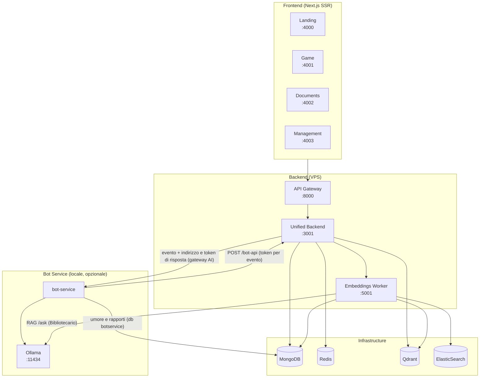

# TenPennyNovels

**Victorian London RPG by Chat Platform**
*Experience immersive roleplay in Victorian London using Call of Cthulhu Rules*

TenPennyNovels is a web-based RPG platform that brings Victorian London to life through real-time chat gameplay, character management, and collaborative storytelling.

## Features

- **Authentic Victorian Experience**: Play in historically accurate 1890s London
- **Call of Cthulhu System**: Full character creation with Victorian-era occupations
- **Real-time Gameplay**: WebSocket-powered chat with dice rolling and character interactions
- **Multiple Gaming Modes**:
  - Location-based in-character chat
  - Victorian postal system for messages
  - Out-of-character chat for players
- **AI-powered NPC Bots**: Intelligent NPCs driven by local Ollama models (zero API costs)
- **Rich Document System**: Setting guides, rules, and historical information with semantic search and AI-powered Q&A
- **Advanced Search**: Hybrid semantic + keyword search with 384D embeddings for intelligent content discovery
- **Community Forum**: Discuss storylines and coordinate with other players
- **Character Directory**: Public character registry with face claim validation and search
- **Ticketing System**: Complete support system with department routing, priority management, and staff assignment
- **Character Management**: Create, develop, and track your Victorian character
- **Admin Tools**: Comprehensive management interface for game masters

## Technology Stack

- **Frontend**: Next.js 16, React, TypeScript, SCSS Modules
- **Backend**: Node.js 24, Express, TypeScript (unified backend)
- **Real-time**: Socket.IO for WebSocket connections
- **Database**: MongoDB 7 with Mongoose ODM
- **Cache/Pub-Sub**: Redis 7 for sessions, caching, and real-time events
- **Search**: Qdrant (vector DB) + ElasticSearch (full-text) for hybrid semantic search
- **ML**: Python sentence-transformers for document embeddings
- **AI**: Ollama (local LLM inference); bot di chat locale in `bot-service/`
- **Authentication**: Custom JWT with HttpOnly cookies

## Architecture

### Overview

The platform consists of 4 frontend applications, 3 backend services, and an optional local bot service.



**Frontend Applications:**

| App | Port | Domain (prod) | Description |
|-----|------|---------------|-------------|
| Landing | 4000 | tenpennynovels.com | Authentication and character selection |
| Game | 4001 | game.tenpennynovels.com | Main gameplay interface with real-time chat, forum |
| Documents | 4002 | documenti.tenpennynovels.com | Setting guides and rules reference |
| Management | 4003 | gestione.tenpennynovels.com | Game master and admin tools |

**Backend Services (VPS):**

| Service | Port | Description |
|---------|------|-------------|
| API Gateway | 8000 | Centralized routing and proxy to unified-backend |
| Unified Backend | 3001 | All modules: auth, game, admin, documents, tickets, forum, WebSocket |
| Embeddings Worker | 5001 | HTTP API + Python subprocess + Bull queue for semantic embeddings; RAG Q&A ("Bibliotecario") via Ollama |

**Bot Service (macchina locale, opzionale — non va in produzione):**

| Service | Port | Description |
|---------|------|-------------|
| bot-service | — | Risponde con un LLM ai messaggi di chat di location configurate; si aggancia al Redis del gioco |
| Ollama | 11434 | LLM inference locale (default `gemma4:12b`) |

> Il bot-service è **separato** dal gioco (oggi il Mac dello sviluppatore, domani un server AI dedicato): il gioco gli **spinge** ogni messaggio pubblico di una location con un bot, insieme all'indirizzo e a un token con cui rispondere; il servizio decide se e cosa rispondere e risponde su `POST /bot-api/messages`. Parte solo con la configurazione completa (`ENABLE_BOT_CHAT`, `BOT_SERVICE_SECRET`, `BOT_REPLY_BASE_URL`, gateway AI); con il servizio spento il bot, semplicemente, non esiste. Il suo stato (umore dei bot, rapporti coi giocatori) sta in un database Mongo separato. Vedi [bot-service/README.md](bot-service/README.md).

## Quick Start

### Prerequisites

- Node.js v24.x (see `.nvmrc`)
- MongoDB 7.x
- Redis 7.x
- Docker (per l'infrastruttura)

### Installation

```bash
# Clone the repository
git clone https://github.com/pagliagen/tenpennynovels.git
cd tenpennynovels

# Install dependencies
npm install

# Configure environment
cp .env.example .env
# Edit .env with your configuration
```

### Start with Docker (recommended)

```bash
# Start all infrastructure + backend services
docker compose up -d

# Verify services are healthy
docker compose ps
```

### Start the bot service (opzionale)

```bash
cd bot-service
cp .env.example .env              # BOT_SERVICE_SECRET uguale a quello del backend
cp bots/barnaby-finch.example.json bots/barnaby-finch.json
cp mapping.example.json mapping.json
ollama pull gemma4:12b
npm install && npm run dev
```

Setup completo (personaggio bot, secret, schede): [bot-service/README.md](bot-service/README.md).

### Start locally (without Docker)

```bash
# Start all backend services
npm run backend:all

# Start all frontend applications (separate terminal)
npm run frontend:all

# Or start everything together
npm run all
```

### Access the Platform

| Service | URL |
|---------|-----|
| Landing/Login | http://localhost:4000 |
| Game Interface | http://localhost:4001 |
| Documents | http://localhost:4002 |
| Management | http://localhost:4003 |
| API Gateway | http://localhost:8000 |

## Project Structure

```
tenpennynovels/
├── apps/                        # Frontend applications (Next.js)
│   ├── landing/                 # Login and character selection
│   ├── game/                    # Main game interface + forum
│   ├── documents/               # Setting guides and rules
│   └── management/              # Admin/game master interface
│
├── services/                    # Backend services (VPS)
│   ├── api-gateway/             # Centralized routing and proxy
│   ├── unified-backend/         # Main backend (all modules)
│   │   └── src/modules/
│   │       ├── auth/            # Authentication
│   │       ├── game/            # Gameplay logic + WebSocket
│   │       ├── admin/           # Admin panel
│   │       ├── documents/       # Document system
│   │       ├── tickets/         # Support tickets
│   │       └── forum/           # Community forum
│   └── embeddings-worker/       # ML embeddings service
│
├── bot-service/                 # Bot di chat con LLM locale (opzionale, solo locale)
│   ├── bots/                    # Una scheda per bot (persona + psicologia)
│   ├── mapping.json             # location → bot
│   └── src/                     # Pipeline a step, umore e rapporti
│
├── scripts/                     # Seeders and utility scripts
├── deploy/                      # Deployment configs
├── docs/                        # Project documentation
├── _archive/                    # Archived code (reference only)
├── docker-compose.yml           # Docker Compose for local dev
└── ecosystem.config.js          # PM2 config for production
```

## Development

### Available Scripts

```bash
# Individual services
npm run backend:gateway          # API Gateway
npm run backend:unified          # Unified Backend
npm run backend:embeddings       # Embeddings Worker

# Groups
npm run backend:all              # All backends
npm run frontend:all             # All frontends
npm run all                      # Everything

# Bot service
npm run bot-service:dev          # Start the bot service
npm run bot-service:test         # Run its tests

# Build
npm run build:all                # Build everything for production
npm run build:backend:all        # Build all backends
npm run build:frontend:all       # Build all frontends

# Seeders
npm run seed:users               # Seed default users
npm run seed:documents           # Seed documents
```

### Docker Commands

```bash
# Game stack (VPS)
docker compose up -d             # Start all services
docker compose down              # Stop all services
docker compose ps                # Check status
```

## Production Deployment

**Game Platform** — runs on an OVH VPS with PM2 and Nginx:

| Domain | Service |
|--------|---------|
| tenpennynovels.com | Landing |
| game.tenpennynovels.com | Game |
| documenti.tenpennynovels.com | Documents |
| gestione.tenpennynovels.com | Management |
| api.tenpennynovels.com | API Gateway |
| ws.tenpennynovels.com | WebSocket |

**Servizi AI** (`ai-gateway/`, `bot-service/`) — non vengono deployati (esclusi dal rsync): oggi girano sul Mac dello sviluppatore dietro un tunnel ngrok, domani su un server AI dedicato. Il gioco li chiama (editoriale, bot di chat) solo con la configurazione completa; con i servizi spenti l'AI semplicemente non c'è.

See [deploy/](deploy/) and [deploy/docs/01-ubuntu-from-zero.md](deploy/docs/01-ubuntu-from-zero.md) for game deployment.

## Documentation

- [docs/INDEX.md](docs/INDEX.md) — Complete documentation index
- [docs/tecnica/](docs/tecnica/README.md) — Documentazione tecnica: backend, frontend, infrastruttura, script
- [docs/tecnica/infrastructure/](docs/tecnica/infrastructure/README.md) — Docker, variabili d'ambiente, MongoDB, Redis, Qdrant
- [docs/tecnica/backend/](docs/tecnica/backend/README.md) — Architettura del backend, endpoint, autenticazione, WebSocket
- [docs/funzionale/](docs/funzionale/README.md) — Funzionalità di gioco (personaggi, chat, location, corporazioni…)
- [docs/tecnica/backend/embeddings-worker.md](docs/tecnica/backend/embeddings-worker.md) — Embedding, ricerca semantica, Q&A «Bibliotecario»
- [deploy/](deploy/README.md) — Deploy e operazioni
- [bot-service/README.md](bot-service/README.md) — Bot di chat: pipeline, schede, umore e rapporti, modelli

## Security

- JWT-based authentication with secure HttpOnly cookies
- Two-tier authorization system (user roles + character gameplay roles)
- Granular admin permissions with per-character overrides
- Rate limiting and input sanitization
- HTTPS enforcement in production
- **Bot service**: l'API di ritorno `/bot-api` è disattivata (404) senza la configurazione completa, richiede un token firmato per evento (valido per UN bot in UNA location, 15 minuti, confronto a tempo costante) e accetta solo personaggi approvati dell'utente di sistema dei bot

## License

This project is licensed under the MIT License - see the [LICENSE](LICENSE) file for details.

---

Made with care for Victorian London RPG enthusiasts
