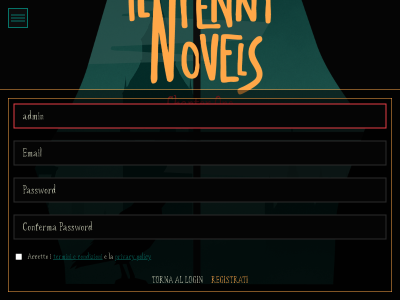
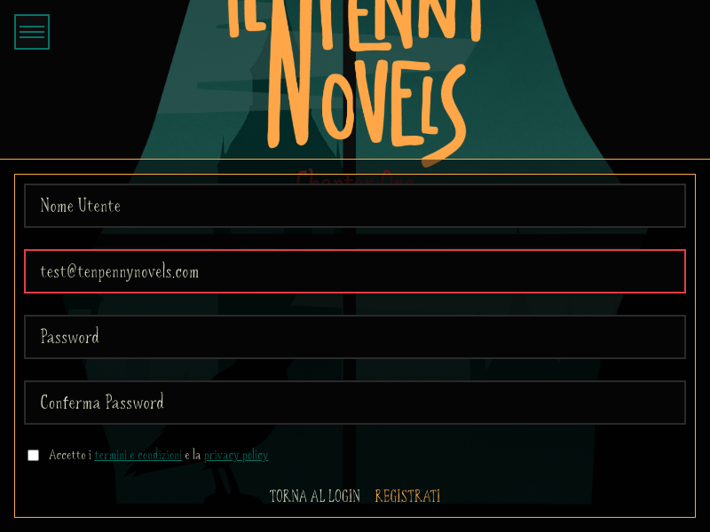
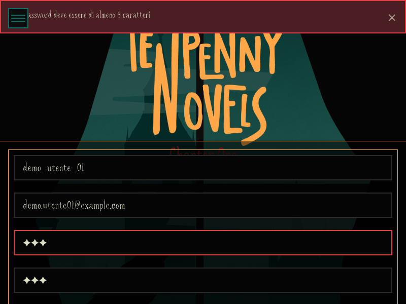
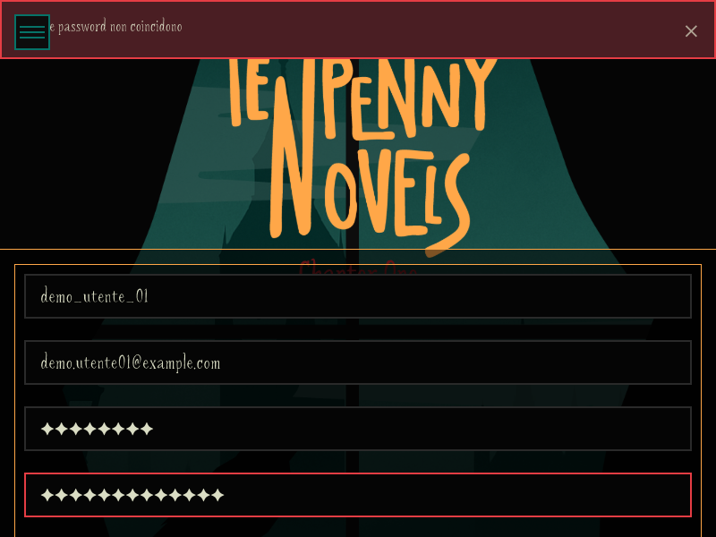
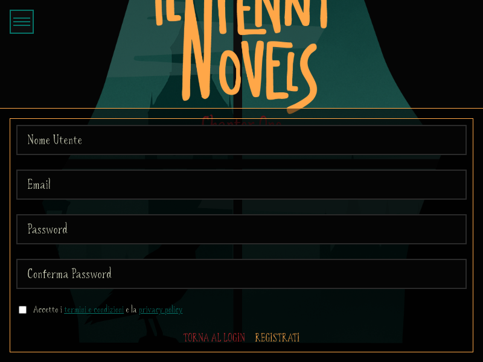
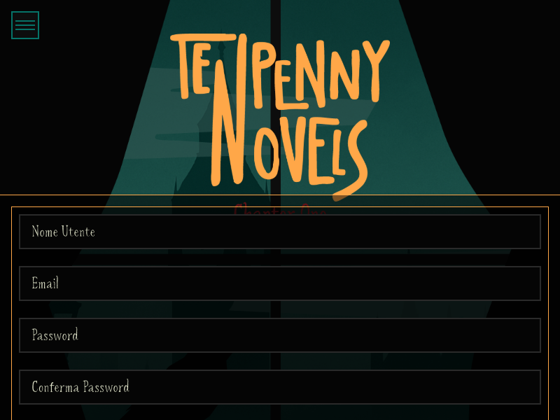
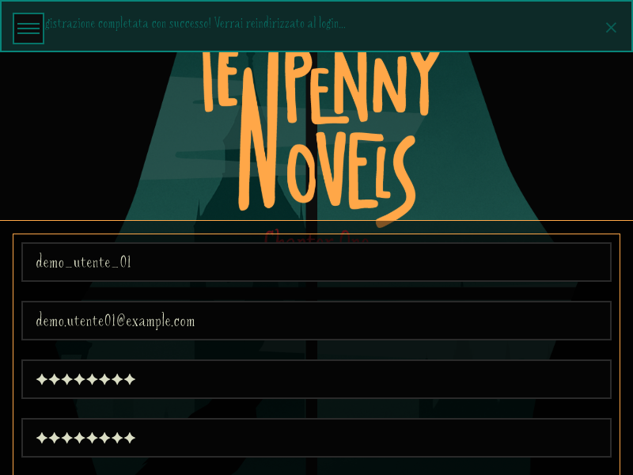
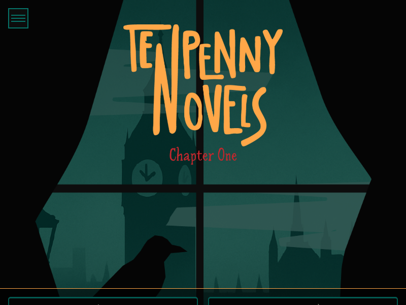
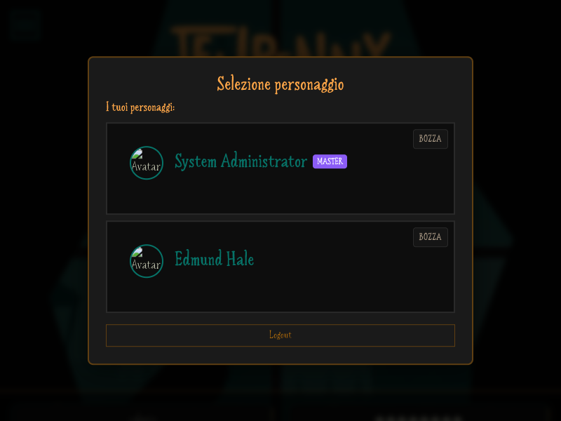

# Guida all'Iscrizione - TenPennyNovels

> **Ultima modifica**: Ottobre 2026 | **Versione guida**: 1.1

## Introduzione

Benvenuto su **TenPennyNovels**! Questa guida ti accompagnerà passo-passo nel processo di registrazione alla piattaforma. L'iscrizione è **completamente gratuita** e richiede circa **5 minuti**.

Al termine della registrazione potrai:
- Creare il tuo primo personaggio ambientato nell'epoca vittoriana
- Esplorare le location del gioco
- Interagire con altri giocatori tramite chat in-character
- Consultare documenti e materiale di gioco

**Requisiti**:
- Un indirizzo email valido
- Un browser moderno (Chrome, Firefox, Safari, Edge)
- Connessione internet stabile

---

## Passo 1: Accedere alla Pagina di Registrazione

1. Vai all'indirizzo **[https://tenpennynovels.com](https://tenpennynovels.com)**
2. Clicca sul pulsante **"Registrati"** nella homepage
3. Verrai reindirizzato alla pagina di registrazione: `https://tenpennynovels.com/register`

> **💡 Nota**: Se hai già un account non serve registrarsi: inserisci le tue credenziali nel modulo della homepage e premi **«Gioca >>»**.

---

## Passo 2: Compilare il Form di Registrazione

Il form di registrazione è composto da **5 campi obbligatori**. Compila tutti i campi seguendo le indicazioni qui sotto.

### 2.1 Nome Utente

Il nome utente è il tuo identificativo univoco sulla piattaforma. Sarà visibile agli altri giocatori.

**Requisiti tecnici**:
- **Lunghezza**: minimo 3 caratteri, massimo 20 caratteri
- **Caratteri consentiti**: lettere (a-z, A-Z), numeri (0-9), underscore (_) e trattini (-). Gli spazi non sono ammessi
- **Restrizioni**: non può iniziare né terminare con underscore o trattino
- **Unicità**: deve essere disponibile (non già usato da altri utenti); maiuscole e minuscole non contano (`Admin` e `admin` sono lo stesso nome)

**Esempi validi**:
- `john_doe`
- `detective1888`
- `mary-watson`
- `Inspector42`

**Esempi NON validi**:
- `_user` ❌ (inizia con underscore)
- `ab` ❌ (troppo corto, minimo 3 caratteri)
- `user@name` ❌ (carattere @ non consentito)
- `username-` ❌ (termina con trattino)
- `user name` ❌ (gli spazi non sono ammessi)

> **💡 Controllo automatico**: dopo il terzo carattere, il sistema verifica se il nome utente è libero. Se è già in uso il campo si colora **di rosso** (come nell'immagine); se resta normale, il nome è disponibile. Non compare nessun segno di spunta e nessun testo sotto il campo.

---

### 2.2 Email

L'indirizzo email sarà utilizzato per:
- **Verificare l'account**: dopo la registrazione ricevi un'email con il link di verifica, senza il quale non puoi accedere
- Recuperare la password in caso di smarrimento
- Ricevere notifiche importanti (opzionale)

**Requisiti tecnici**:
- **Formato**: deve essere un indirizzo email valido (es. `nome@dominio.com`)
- **Lunghezza**: massimo 100 caratteri
- **Unicità**: ogni email può essere registrata una sola volta
- **Privacy**: l'email NON sarà visibile agli altri giocatori

**Esempi validi**:
- `john.doe@example.com`
- `detective1888@gmail.com`
- `mary_watson@protonmail.com`

> **⚠️ Attenzione**: se l'email è già associata a un altro account il campo si colora **di rosso**, come per il nome utente. Usa un'altra email oppure recupera l'accesso all'account esistente (vedi «Password dimenticata»).

---

### 2.3 Password

La password protegge il tuo account. Scegli una password sicura e facile da ricordare.

**Requisiti**:
- **Lunghezza minima**: 4 caratteri. Non ci sono altri vincoli (lettere, numeri o simboli sono liberi)
- **Consigliato**: una password molto più lunga e varia del minimo, con lettere, numeri e simboli (es. `!`, `@`, `#`, `$`, `%`)

**Esempi validi**:
- `MyPassword123`
- `detective2024!`
- `VictorianEra88`
- `Tenp3nny!Novels`

**Esempio NON valido**:
- `abc` ❌ (troppo corta, minimo 4 caratteri)

> **ℹ️ Dove compare l'errore**: i controlli sui campi scattano quando premi **Registrati**. Il messaggio (qui «Password deve essere di almeno 4 caratteri») compare in un **banner in alto** e il campo interessato si colora di rosso. Non c'è un indicatore dei requisiti mentre digiti.

> **🔒 Consigli per una password sicura**:
> - Non usare informazioni personali facilmente individuabili (nome, data di nascita)
> - Evita password comuni o sequenze semplici (es. `password123`, `qwerty123`)
> - Usa una combinazione di lettere maiuscole, minuscole, numeri e simboli
> - Considera l'uso di un password manager per memorizzare password complesse

---

### 2.4 Conferma Password

Questo campo serve a verificare che tu abbia digitato correttamente la password scelta.

**Requisiti**:
- Deve **coincidere esattamente** con il campo "Password"
- Fai attenzione a maiuscole/minuscole e caratteri speciali

> **⚠️ Errore comune**: se le due password non coincidono, premendo **Registrati** vedrai nel banner in alto il messaggio «Le password non coincidono». Verifica di aver digitato la stessa password in entrambi i campi.

---

### 2.5 Accettazione Termini e Condizioni

Prima di completare la registrazione, devi accettare i **Termini e Condizioni** e la **Privacy Policy** della piattaforma.

**Come procedere**:
1. Clicca su «termini e condizioni» e su «privacy policy»: i testi si aprono **nella stessa pagina** (non su una pagina separata); un secondo clic li richiude
2. **Spunta la checkbox** per confermare l'accettazione

> **⚠️ Campo obbligatorio**: non potrai completare la registrazione senza accettare i termini. Se premi **Registrati** senza spuntare la checkbox, il banner in alto dice «Devi accettare i termini e condizioni».

---

## Passo 3: Inviare la Registrazione

Dopo aver compilato tutti i campi correttamente, sei pronto per completare la registrazione.

1. **Verifica i dati inseriti**: controlla che tutte le informazioni siano corrette
2. Clicca sul pulsante **"Registrati"** in fondo al form
3. Il sistema elaborerà la richiesta (potrebbero servire alcuni secondi)

**Se la registrazione ha successo**:
- Vedrai un **banner verde** con il messaggio «Registrazione completata con successo! Verrai reindirizzato al login...»
- Verrai **reindirizzato automaticamente** alla pagina di login dopo 5 secondi

> **📧 Verifica dell'email (obbligatoria)**: ti arriva un'email con il link di verifica. **Finché non lo apri non puoi accedere**: il login risponde «Verifica il tuo indirizzo email prima di effettuare il login». Controlla anche la cartella dello spam. Se non l'hai ricevuta, prova ad accedere: sotto il messaggio compare il pulsante **«Reinvia Email di Verifica»**.

---

## Passo 4: Primo Accesso

Dopo la registrazione, verrai portato alla schermata di login.

**Credenziali di accesso**:
- **Username**: il nome utente che hai scelto durante la registrazione
- **Password**: la password che hai impostato

**Procedura**:
1. Inserisci il tuo **username**
2. Inserisci la tua **password**
3. Clicca su **«Gioca >>»**

### Il tuo personaggio

Alla registrazione il sistema crea per te un primo personaggio, **in bozza**. Con un solo personaggio l'accesso ti porta **direttamente nel gioco**, dove completi la creazione del personaggio.

Se il tuo account ha **più di un personaggio** (ad esempio un personaggio di gioco e uno assegnato dallo staff), dopo il login compare la schermata **«Selezione personaggio»**: scegli con quale entrare. Accanto al nome vedi lo stato (**Bozza** per i personaggi non ancora approvati) e, se presente, il ruolo.

> **📖 Continua con la guida**: Per istruzioni dettagliate sulla creazione del personaggio, consulta la **Guida alla Creazione del Personaggio *(guida in preparazione)*** *(coming soon)*.

---

## Risoluzione Problemi Comuni

### 1. Il campo «Nome utente» è rosso

**Problema**: Il nome utente che hai scelto è già utilizzato da un altro giocatore.

**Soluzioni**:
- Prova una variante del nome (es. `john_doe` → `john_doe88`)
- Aggiungi numeri, underscore o trattini (es. `detective` → `detective-1888`)
- Scegli un nome completamente diverso

---

### 2. Il campo «Email» è rosso

**Problema**: L'indirizzo email è già associato a un account esistente.

**Soluzioni**:
- **Se hai già un account**: Vai alla pagina di login e accedi con le tue credenziali
- **Se hai dimenticato la password**: Usa la funzione "Password dimenticata" nella pagina di login
- **Altrimenti**: Usa un indirizzo email diverso

---

### 3. «Password deve essere di almeno 4 caratteri»

**Problema**: La password è più corta del minimo.

**Soluzione**: scegli una password di almeno **4 caratteri** (meglio molto di più: il sistema non impone altro, quindi la robustezza dipende da te).

---

### 4. "Devi accettare i termini e condizioni"

**Problema**: Hai dimenticato di spuntare la checkbox dei termini.

**Soluzione**:
1. Scorri fino alla riga «Accetto i termini e condizioni e la privacy policy»
2. **Spunta la checkbox**
3. Premi di nuovo **Registrati**

---

### 5. Il banner dice «Nome utente già in uso» o «Indirizzo email già registrato»

**Problema**: il nome utente o l'email sono già associati a un altro account; il campo interessato resta rosso.

**Soluzioni**: cambia il valore, oppure se l'account è tuo accedi o usa «Password dimenticata».

---

### 5b. Errore generico o di connessione

**Soluzioni**:
1. **Controlla la connessione internet**
2. **Ricarica la pagina** (F5 o Ctrl+R) e riprova
3. Se il problema persiste, prova a **svuotare la cache del browser** o usa la **navigazione in incognito**

---

### 6. Il redirect al login non funziona

**Problema**: Dopo la registrazione, rimani sulla pagina di registrazione invece di essere reindirizzato al login.

**Soluzioni**:
- Vai direttamente a `https://tenpennynovels.com/`: è la pagina di login
- Se non vedi il messaggio di successo, verifica se la registrazione è andata a buon fine tentando il login (se l'account esiste ma non è verificato, il login te lo dice)

---

### 7. «Verifica il tuo indirizzo email prima di effettuare il login»

**Problema**: Hai provato ad accedere senza aver aperto il link di verifica.

**Soluzioni**:
1. Apri l'email di verifica ricevuta alla registrazione (controlla anche lo spam)
2. Se non c'è, riprova ad accedere e usa il pulsante **«Reinvia Email di Verifica»**

---

### 8. "Errore di connessione" o "Impossibile contattare il server"

**Problema**: Problemi di rete o server temporaneamente non disponibile.

**Soluzioni**:
1. **Verifica la connessione internet**
2. **Riprova dopo alcuni minuti** (il server potrebbe essere in manutenzione)
3. **Prova da un altro browser** o dispositivo
4. Se il problema persiste per più di 30 minuti, riprova più tardi o contatta lo staff

---

## Domande Frequenti (FAQ)

### Serve una conferma via email?

**Sì.** Dopo la registrazione ricevi un'email con un link di verifica: finché non lo apri il login è bloccato («Verifica il tuo indirizzo email prima di effettuare il login»). Se non la trovi, controlla lo spam o usa «Reinvia Email di Verifica» dalla pagina di login. L'email serve anche a recuperare l'account in caso di password dimenticata.

---

### Posso cambiare il mio username dopo la registrazione?

**No**, al momento non è possibile modificare il nome utente dopo la registrazione. Scegli con attenzione il tuo username, poiché sarà **permanente** e visibile agli altri giocatori.

> **💡 Consiglio**: Se hai registrato un account con un username che non ti piace, considera di creare un nuovo account con una email diversa (ma nota che perderai eventuali progressi fatti con il vecchio personaggio).

---

### Posso registrare più account con la stessa email?

**No**, ogni indirizzo email può essere associato a **un solo account**. Se hai bisogno di creare più personaggi, puoi farlo all'interno dello stesso account senza necessità di registrarti più volte.

> **ℹ️ Multi-personaggio**: TenPennyNovels supporta la creazione di **più personaggi per account**. Non serve registrare account multipli.

---

### La piattaforma è mobile-friendly?

**Sì**, il sito è completamente **responsive** e ottimizzato per dispositivi mobili (smartphone e tablet). Puoi registrarti e giocare sia da desktop che da mobile.

---

### L'iscrizione è a pagamento?

**No**, la registrazione e l'uso della piattaforma sono **completamente gratuiti**. Non ci sono costi nascosti né abbonamenti richiesti.

---

### Qual è l'età minima per registrarsi?

L'età minima consigliata è **13 anni**. I minori di 18 anni dovrebbero chiedere il permesso ai genitori o ai tutori prima di registrarsi.

> **⚠️ Attenzione**: I contenuti del gioco sono ambientati nell'epoca vittoriana e possono contenere temi maturi. La supervisione di un adulto è consigliata per i giocatori più giovani.

---

### Posso eliminare il mio account?

Sì, puoi richiedere la cancellazione del tuo account. La cancellazione è permanente e comporta la perdita di tutti i dati associati (personaggi, progressi, messaggi).

---

### Cosa succede se dimentico la password?

Se sbagli la password, sotto il messaggio di errore compare il pulsante **«Password dimenticata? Clicca qui per resettarla»**. Segui la procedura di recupero password: riceverai un'email con le istruzioni per reimpostare la tua password.

> **📧 Email di recupero**: Assicurati che l'indirizzo email fornito durante la registrazione sia valido e accessibile.

---

## Link Utili

- **Termini e Condizioni** e **Privacy Policy** - si leggono dal form di registrazione (clic sul relativo link accanto alla checkbox)
- **Guida Creazione Personaggio *(guida in preparazione)*** *(coming soon)* - Tutorial per creare il tuo primo personaggio
- **[Documentazione Funzionale](../funzionale/autenticazione.md)** - Dettagli tecnici sul sistema di autenticazione

---

## Conclusione

Congratulazioni! Ora sai come registrarti su TenPennyNovels. Se hai seguito questa guida, dovresti avere un account attivo e essere pronto a creare il tuo primo personaggio vittoriano.

**Prossimi passi**:
1. Crea il tuo primo personaggio → Guida Creazione Personaggio *(guida in preparazione)* *(coming soon)*
2. Esplora le location disponibili
3. Inizia a interagire con altri giocatori

**Buon divertimento su TenPennyNovels!** 🎩✨

---

_Ultimo aggiornamento: Ottobre 2026 | Versione: 1.1 | Autore: Team TenPennyNovels_
