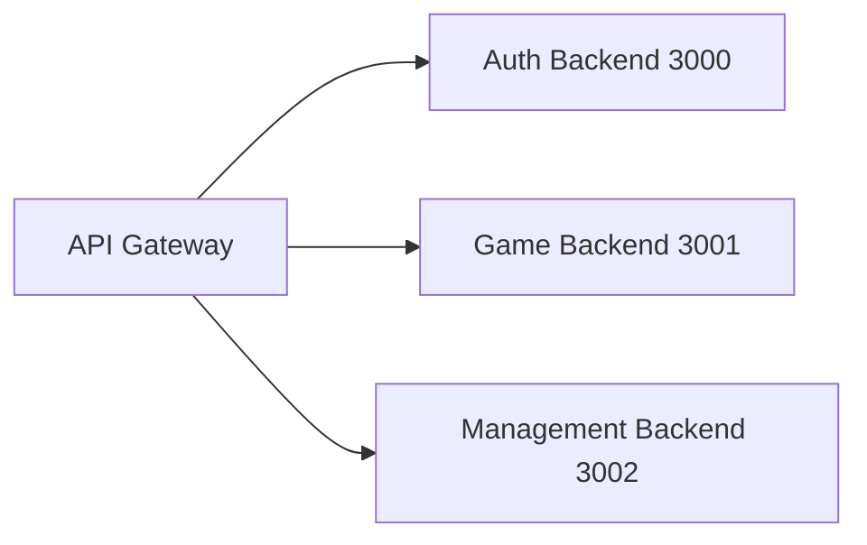
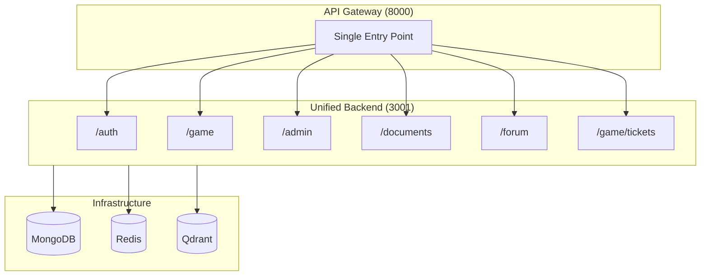
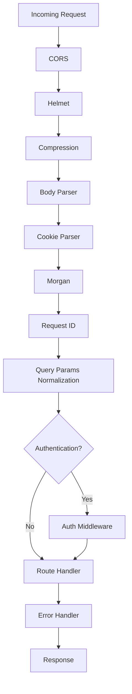

# Unified Backend Architecture

**Navigation**: [Home](../../INDEX.md) > [Backend](./README.md) > Unified Backend

**Status**: ✅ Production Ready | **Last Updated**: 2026-07-25

Complete documentation of the TenPennyNovels Unified Backend architecture — modular structure with all services consolidated in a single Express application.

---

## Overview

TenPennyNovels uses a **Unified Backend** that consolidates all backend logic (authentication, game, admin and the feature modules: documenti, forum, tickets, economia, bot, editoriale…) in a single Express service.

**Key Benefits**:
- ✅ **Single Deployment**: One process, one port (3001)
- ✅ **Shared Resources**: MongoDB connection pool, Redis client, shared middleware
- ✅ **Zero Breaking Changes**: API Gateway maintains same path prefixes
- ✅ **Simplified Infrastructure**: Fewer containers, less complexity
- ✅ **Hot-Reload Dev**: tsx watch for rapid development

**Previous Architecture** (deprecated):


**Current Architecture**:


**Struttura reale (dopo il refactor «feature modules»)**: `core/` (dominio condiviso, tra cui `core/auth`), `features/` (17 feature con il proprio manifest) e `modules/game` + `modules/admin`. Vedi «Struttura del codice» più sotto: le vecchie «6 moduli» (`auth`, `documents`, `forum`, `tickets` sotto `modules/`) non esistono più.

---

## Entry Point & Technology Stack

| Component | Version |
|-----------|---------|
| **Entry Point** | `src/server.ts` → `src/app.ts` |
| **Port** | 3001 |
| **Node.js** | 24.x (`.nvmrc`: v24.18.0) |
| **Express** | 5.2.1 |
| **TypeScript** | 5.9 |
| **Mongoose** | 9.2.1 |
| **Socket.IO** | 4.8.3 |

---

## Struttura del codice

Il codice è diviso in tre livelli (fonte di verità: il codice; i confini sono controllati da `npm run lint:boundaries`):

```
services/unified-backend/src/
├── core/                  # dominio condiviso da più feature
│   ├── auth/              # utenti, JWT, sessioni personaggio, middleware auth (montato su /auth)
│   ├── character/         # modello Character
│   ├── chat/              # modello Chat e chat action types
│   ├── location/          # modello Location, tag, servizi
│   ├── features/          # registry, bootstrap, flag (FeatureFlagService), requireFeature
│   ├── extensions/        # punti di estensione (enricher, azioni di chat)
│   └── ai/                # AiGatewayClient: gateway dei servizi AI (probe, call, generate)
├── features/              # 17 feature, ciascuna con manifest.ts (+ api.ts pubblico)
├── modules/
│   ├── game/              # logica di gioco (controller, WebSocket, eventi, job) — montato su /game
│   └── admin/             # pannello admin — montato su /admin
├── config/ cron/ database/ shared/ scripts/ types/
├── app.ts                 # setup Express; monta /auth, /game, /admin e chiama bootstrapFeatures()
└── server.ts              # entry point: connessioni (Mongo, Redis), WebSocket, CRON
```

**Come si monta una feature.** `app.ts` monta direttamente `/auth` (`core/auth`), `/game` (`modules/game`) e `/admin` (`modules/admin`);
**tutte le feature** si montano da `bootstrapFeatures(app, FEATURES)` (`features/index.ts`) secondo il loro manifest: ogni `routes[]`
dichiara `scope` (`public` → prefisso vuoto, `game` → `/game`, `admin` → `/admin`), `path` relativo e `gated` (default: 404 se la feature è spenta,
via `requireFeature`). Una feature può avere un **flag** runtime (`SystemConfiguration`, cache Redis, modificabile dal gestionale) o d'ambiente
(es. `ENABLE_IA_EDITORIAL`, `ENABLE_BOT_CHARACTERS`, `ENABLE_BOT_CHAT`). Gli import fra feature passano solo da `features/<x>/api.ts`
(più `dependsOn` nel manifest).

| Feature | Cosa fa | Montaggio (scope `path`) |
|---|---|---|
| `bibliotecario` | Q&A sui documenti (RAG), flag runtime `keeper_qa_enabled` | estensione di `documenti` |
| `botAdmin` | tab «Bot» del gestionale: elenco e generazione dei bot | admin `/bots` (flag d'ambiente + servizio AI) |
| `botChat` | chat dei bot con servizio AI esterno: inoltro degli eventi e API di risposta | public `/bot-api` (config completa o 404) |
| `confronti` | confronti (attacco/reazione) | game `/chats` |
| `corporazioni` | corporazioni e relazioni | game `/`, admin `/corporations` |
| `documenti` | documenti, sottotipi, ricerca, descrizione SEO | public `/documents`, admin `/documents`, `/subtypes` |
| `economia` | classi sociali, finanze | game `/`, admin `/social-classes` |
| `editorial` | revisione di canone (sempre attiva) e funzioni AI editoriali (flag) | admin `/editorial`, `/editorial/ai` |
| `fineSessione` | chiusura scene e riassunti | game `/` |
| `forum` | forum | public `/forum`, admin `/forum-*` |
| `itemUse`, `skillCheck`, `statCheck` | azioni di chat (uso oggetti, prove) | nessuna rotta: estendono la chat |
| `occupazioni` | occupazioni | game `/occupations`, admin `/occupations` |
| `offGameMessages` | messaggi e chat off-game, mail | game `/`, admin `/messaging`, `/mail` |
| `oggetti` | oggetti e inventario | game `/items`, `/`, admin `/items` |
| `tickets` | ticket di supporto | game `/`, admin `/tickets` |

I dettagli di ogni area (endpoint, permessi, modelli) stanno nelle rules (`.claude/rules/20-backend.md`) e in `api-endpoints.md`.
Le sezioni dettagliate per modulo che c'erano qui (auth, documents, forum, tickets sotto `modules/`) descrivevano una struttura precedente al refactor e sono state rimosse.

---

## Technology Stack

### Framework — Express 5.2.1

**Why Express 5?**
- ✅ **Promise Support**: Automatic promise rejection handling
- ✅ **Async/Await**: No more `next()` callbacks in async routes
- ✅ **Performance**: Improved routing performance

**Example**:
```typescript
// Express 5 - automatic error handling
app.get('/characters', async (req, res) => {
  const characters = await Character.find();
  res.json({ success: true, data: characters });
  // If promise rejects, error middleware catches it automatically
});
```

---

### ORM — Mongoose 9.x

**Connection**:
```typescript
// src/database/index.ts
import mongoose from 'mongoose';

export async function connectDatabase() {
  await mongoose.connect(process.env.MONGODB_URI!, {
    maxPoolSize: 10,
    minPoolSize: 2,
    serverSelectionTimeoutMS: 5000
  });
  logger.info('MongoDB connected successfully');
}
```

**Details**: [MongoDB Schemas](../infrastructure/mongodb-schemas.md)

---

### WebSocket — Socket.IO 4.8.3

**Features**:
- **Room-Based Broadcasting**: Targeted events per location/session
- **Redis Adapter**: Multi-instance synchronization
- **Automatic Reconnection**: Client resilience

**Details**: [WebSocket Patterns](../frontend/websocket-patterns.md)

---

## Database Architecture

### MongoDB — collection (elenco indicativo)

> Elenco indicativo: la verità sono i modelli (`.claude/context/database-schema.md` dice dove cercarli). I conteggi per categoria possono essere indietro.

**Categories**:
1. **Core** (3): User, CharacterSession, SystemConfiguration
2. **Characters** (3): Character, CharacterProgression, CharacterFinances
3. **Locations & Gameplay** (4): Location, Chat, Route, CharacterNotes
4. **Housing & Economy** (1): LocationProperty *(removed: EstateTransaction, Economy, FinancialTransaction)*
5. **Messaging** (7): OnGameMessage, OnGameMessageView, OffGameChat, OffGameChatMessage, etc.
6. **Documents** (3): Document, DocumentSection, DocumentChunk
7. **Gaming Sessions** (3): GamingSession, SessionManagement, SessionTemplate *(removed: Campaign)*
8. **Tickets** (3): Ticket, TicketMessage, TicketNotification
9. **Corporations** (2): Corporation, CharacterRelation
10. **Game Rules** (3): Occupation, Skill, SocialClassConfig
11. **Items** (1): Item
12. **Experience** (0): *(removed: ExperienceGrant)*
13. **Moderation** (2): ChatModerationAction, BroadcastMessage
14. **System** (1): WebSocketEvent

---

## Middleware Stack

### Request Flow



---

## Event-Driven Architecture

### Redis Pub/Sub Channels

Famiglie di canali pubblicate dal backend (elenco non esaustivo; dettagli in [redis-pubsub.md](../infrastructure/redis-pubsub.md) e nel codice):

| Canale | Chi pubblica | Chi legge |
|---|---|---|
| `embedding:document:*`, `embedding:chat:*`, `embedding:forum_post:*` | hook dei modelli (create/update/delete) | `embeddings-worker` |
| `bot:chat:message` | `BotChatEventPublisher` (solo con la chat dei bot configurata per intero) | `BotChatForwarder` (stesso backend → servizio AI esterno) |
| `auth:*`, `user:events` | `core/auth` (registrazione, login, reset password…) | `RedisSubscriber` (`modules/game/events`) |
| `ticket:events` | feature `tickets` | `RedisSubscriber` |
| `system_config_updated`, `system_config_cache_invalidated` | `ConfigurationService` | `ConfigurationService` (cache dei flag) |

---

## Development Workflow

### Hot-Reload Setup

```bash
# Start development server
npm run dev

# tsx watch automatically reloads on file changes
# No build step needed
```

---

## Quick Reference

| Property | Value |
|----------|-------|
| **Port** | 3001 |
| **Entry Point** | `src/server.ts` → `src/app.ts` |
| **Framework** | Express 5.2.1 |
| **ORM** | Mongoose 9.x (`^9.8`) |
| **WebSocket** | Socket.IO 4.8.3 |
| **Node** | 24.x (`.nvmrc`: v24.18.0) |
| **TypeScript** | 5.9 |
| **Montaggio** | `/auth` (core), `/game`, `/admin`, più le 17 feature da `bootstrapFeatures()` |

---

## Related Documentation

- [API Gateway](./api-gateway.md) - Proxy routing
- [Authentication System](./authentication.md) - JWT system
- [API Reference](./api-endpoints.md) - Complete endpoint list
- [MongoDB Schemas](../infrastructure/mongodb-schemas.md) - Database structure
- [WebSocket Patterns](../frontend/websocket-patterns.md) - Eventi real-time
- [Deploy README](../../../deploy/README.md) - Produzione
